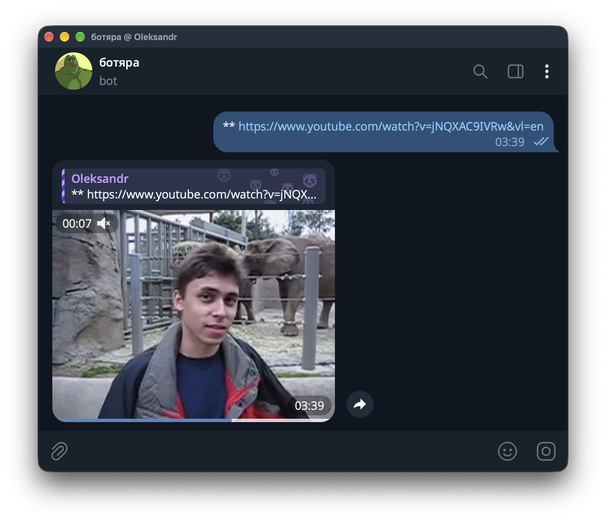

# Video Downloader Bot

Download videos into Telegram, with automatic compression and optional AI replies.

**Python 3.14 · Docker · MIT**

[Quick start](#quick-start) · [Usage](#usage) · [Configuration](#configuration) · [Other deployment options](#other-deployment-options) · [Development](#development)

Send a TikTok, Instagram, Reddit, X (`x.com`), Facebook or YouTube Shorts link. The bot
downloads the media and replies in the same chat. Full YouTube videos and other
yt-dlp-supported URLs can be requested with the `**` prefix.

<a href="assets/readme/telegram-download.png"></a>

*A real download: `**` enables full YouTube video URLs.*

## Quick start

Install Docker with Compose, then clone this repository:

```shell
git clone https://github.com/ovchynnikov/load-bot-linux.git
cd load-bot-linux
cp .env.example .env
```

Get a token from [@BotFather](https://t.me/botfather) and set `BOT_TOKEN` in `.env`.
Set `SEND_ERROR_TO_ADMIN=false` for the first run; you can configure
[admin alerts](#access-control-and-admin-alerts) later. Choose `LANGUAGE=en` or `LANGUAGE=uk`.

```shell
docker compose up -d --build
```

Check container status and recent logs:

```shell
docker compose ps
docker compose logs --tail=50 bot
```

Look for `Application started`, then send `bot_health` in a private chat with the bot.
For group use, [disable privacy mode](https://core.telegram.org/bots/features#privacy-mode)
in @BotFather (`/setprivacy` → Disable), then remove and re-add the bot to the group.
Making the bot a group admin also allows it to receive ordinary messages.

> The sample configuration allows everyone to use the bot. Set up
> [access control](#access-control-and-admin-alerts) before sharing it if needed.

Compose keeps the database in the `bot-data` volume. Preserve it when updating
the bot: it contains conversation history and search quotas.

## Usage

| Send to the bot | Result |
| --- | --- |
| A TikTok, Instagram, Reddit, X (`x.com`), Facebook or YouTube Shorts URL | Download the media |
| `**` + a full YouTube URL | Request a full YouTube video |
| `bot_health` | Check that the bot responds |
| `ботяра, explain this` | AI reply, when chat is enabled |
| `ботяра, web: latest space news` | Require Grok web search, when enabled |
| `ботяра, image: a sunset over mountains` | Generate an image using a Grok API key |

For a full YouTube video, send:

```text
**https://www.youtube.com/watch?v=VIDEO_ID
```

The bot enforces a **12-minute video limit** and tries to compress files larger
than **50 MiB**. Files that remain too large are rejected. The `**` prefix also
allows trying other [yt-dlp-supported sites](https://github.com/yt-dlp/yt-dlp/blob/master/supportedsites.md);
availability depends on the site and any required login.
With AI chat disabled, `ботяра, ...` returns a random canned reply.
Unsupported URLs get a reply in private chats and are ignored in groups;
use `x.com` instead of `twitter.com` links, or try the `**` prefix.

## Configuration

Use [`.env.example`](.env.example) as the configuration reference.
Change `.env` and recreate the Compose service to apply settings:

```shell
docker compose up -d --force-recreate
```

| Setting | Purpose |
| --- | --- |
| `BOT_TOKEN` | Telegram bot token; required |
| `LANGUAGE` | `en` or `uk`; the template selects `en`, the code default is `uk` |
| `LOG_LEVEL` | Log verbosity; default `INFO` |
| `H_CODEC` | CPU compression codec; default `libx265`, alternatively `libx264` |
| `USE_LLM` | Enable AI chat; default `false` |
| `USE_CONVERSATION_CONTEXT` | Include saved per-user chat context; default `true` |

Inactive users' saved context is eligible for cleanup after `USER_CLEANUP_TTL_DAYS`
(default 3 days), checked every `USER_CLEANUP_INTERVAL_HOURS` (default 24 hours).

Keep `.env` values free of inline comments and surrounding quotes for compatibility
with `docker run --env-file`. Never commit tokens or cookie files.

### AI replies and web search

For Grok chat, set:

```ini
USE_LLM=true
LLM_PROVIDER=grok
GROK_API_KEY=YOUR_XAI_KEY
```

The configured defaults are `GROK_MODEL=grok-4.3` and
`GROK_REASONING_EFFORT=low`. For Gemini, use `LLM_PROVIDER=gemini` with
`GEMINI_API_KEY` instead. Address the bot with `ботяра, ...` to request a reply.
Image generation requires `GROK_API_KEY` and works independently of the chat
provider and `USE_LLM`.

To add web search to Grok chat:

```ini
GROK_WEB_SEARCH_ENABLED=true
GROK_WEB_SEARCH_MODE=auto
```

In `auto` mode Grok decides when to search; `ботяра, web: ...` requires a search.
Use `explicit` mode to offer search only for that command. No separate search key
is needed. Replies include source links when available; failed-search fallback
answers are labeled as unverified. Gemini does not use this search integration.

> Search is paid. Default admission limits are 20 search-enabled requests per user
> and 50 across the bot per UTC day. These are request limits, **not spending caps**;
> one request can make multiple paid tool calls. Quotas and other limits are in
> [`.env.example`](.env.example).

Set `GROK_WEB_SEARCH_ENABLED=false` to stop admitting new searches; requests
already running may finish. Chat has its own rate limits and bounded queue.

### Access control and admin alerts

To restrict access, set:

```ini
LIMIT_BOT_ACCESS=true
ALLOWED_USERNAMES=username1,username2
ALLOWED_CHAT_IDS=12345,-1001234567890
```

A matching username **or** chat ID grants access. Usernames omit `@`.
To discover IDs, temporarily set `SEND_USER_INFO_WITH_HEALTHCHECK=true`, recreate
the service, and send `bot_health` in each chat whose ID you need. For groups,
first [configure privacy mode](#quick-start) or make the bot an admin. Do this before
enabling access restrictions, or allow your username first. Use private-chat IDs
for personal admin notifications and group IDs for group allowlists. Then fill
the settings, turn healthcheck info off and recreate the service again.

Admin error messages require `SEND_ERROR_TO_ADMIN=true` and `ADMINS_CHAT_IDS`.
Brief polling transport failures stay in logs. Incidents lasting at least
`POLLING_NETWORK_ALERT_GRACE_SEC` (default 120 seconds) get a summary after
recovery; separate shorter incidents do not accumulate. Other errors retain
their normal alerts. `POLLING_NETWORK_ALERTS_ENABLED=false` restores ordinary
polling error handling.

### Cookies and Intel GPU

For Instagram or Reddit login, export a Netscape-format cookie file as
`instagram_cookies.txt` or `reddit_cookies.txt`. Enable `INSTACOOKIES=true` or
`REDDITCOOKIES=true`, and only then uncomment the matching mount in `docker-compose.yml`.
Create the host file first: a missing file path can become a directory mount.
Mounts must be writable because yt-dlp updates the cookie jar. Cookies are
provided at runtime and are excluded from the image.

Intel VAAPI compression requires `USE_GPU_COMPRESSING=true`, a compatible host
GPU/driver, and container access to `/dev/dri`. Add under `services.bot` in Compose:

```yaml
devices: ["/dev/dri:/dev/dri"]
group_add: [video]
```

For a Docker CLI deployment, add
`--device /dev/dri:/dev/dri --group-add video` to the command below. Device
permissions must match the host; availability depends on the hardware.

## Other deployment options

<details>
<summary>Docker CLI</summary>

With a configured `.env`, use the prebuilt Linux amd64 image:

```shell
docker run -d --name downloader-bot --restart unless-stopped --env-file .env \
  -v bot-data:/bot/data \
  ovchynnikov/load-bot-linux:latest
```

Alternatively, build this checkout with `docker build -t downloader-bot:local .`
and use `downloader-bot:local` as the image in that command.
Run only one deployment per bot token; stop an existing Compose service before
switching to Docker CLI.

Add cookie mounts as needed, for example
`-v "$PWD/instagram_cookies.txt:/bot/instagram_cookies.txt"`.
Follow logs with `docker logs -f downloader-bot`.

</details>

<details>
<summary>Python and systemd</summary>

On Linux, install Python 3.14 and system FFmpeg (`ffmpeg` and `ffprobe` on `PATH`).
From the repository root, with `.env` configured:

```shell
python3.14 -m venv venv
venv/bin/python -m pip install -r src/requirements.txt
cd src
../venv/bin/python main.py
```

For systemd, adapt this unit to your checkout path and service account, then save
it as `/etc/systemd/system/downloader-bot.service`:

```ini
[Unit]
Description=Telegram Video Downloader
After=network-online.target
Wants=network-online.target

[Service]
User=YOUR_SERVICE_USER
WorkingDirectory=/opt/load-bot-linux/src
EnvironmentFile=/opt/load-bot-linux/.env
ExecStart=/opt/load-bot-linux/venv/bin/python /opt/load-bot-linux/src/main.py
Restart=on-failure
RestartSec=5

[Install]
WantedBy=multi-user.target
```

Stop the manual run before starting the service. Place optional cookie files in
`src/`, the service's working directory, and make them writable by its account.

```shell
sudo systemctl daemon-reload
sudo systemctl enable --now downloader-bot.service
journalctl -u downloader-bot.service -f
```

Back up `src/data/` to preserve the native installation's database.

</details>

## Troubleshooting

Start with service status and recent logs:

```shell
docker compose ps
docker compose logs --tail=100 bot
```

| Symptom | Check |
| --- | --- |
| No reply | Token, service logs, access allowlist; try `bot_health` in private chat |
| Works privately, silent in a group | Disable privacy mode and re-add the bot, or make it a group admin |
| YouTube URL ignored | Use a Shorts URL or add `**` before a full video URL |
| Instagram or Reddit download fails | Login cookies, file mounts, expiration and available disk space |
| AI does not reply | `USE_LLM`, selected provider's API key and the `ботяра, ...` prefix |
| GPU compression fails | Intel driver support and access to `/dev/dri`; try CPU compression |

For more detail, temporarily set `LOG_LEVEL=DEBUG` and recreate the service.
Preserve the database when investigating storage errors; do not delete it as a
routine troubleshooting step.

## Development

Use the native Python environment above, then run the offline tests from the
repository root:

```shell
PYTHONPATH=src venv/bin/python -m unittest discover -s tests -v
```

Tests use dummy credentials and offline transports; no real API keys are needed.
See [AGENTS.md](AGENTS.md) for the exact Black, Pylint and JSON checks used for
verification. Keep both English and Ukrainian responses in sync when contributing.

## License and credits

[MIT license](LICENSE). Originally created by Ovchynnikov.
Powered by [yt-dlp](https://github.com/yt-dlp/yt-dlp),
[gallery-dl](https://github.com/mikf/gallery-dl),
[python-telegram-bot](https://github.com/python-telegram-bot/python-telegram-bot)
and [FFmpeg](https://ffmpeg.org).
